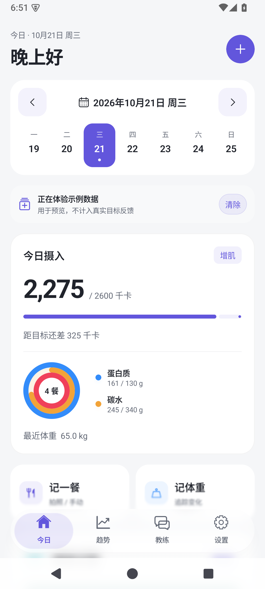
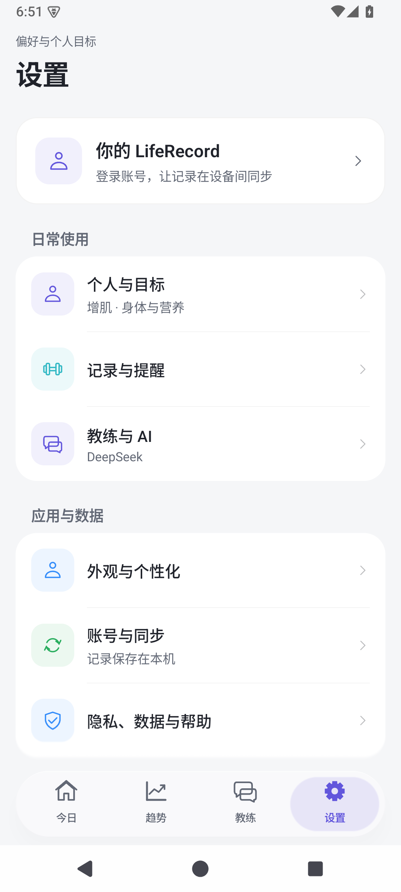
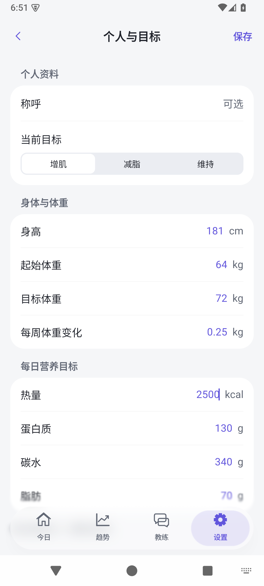
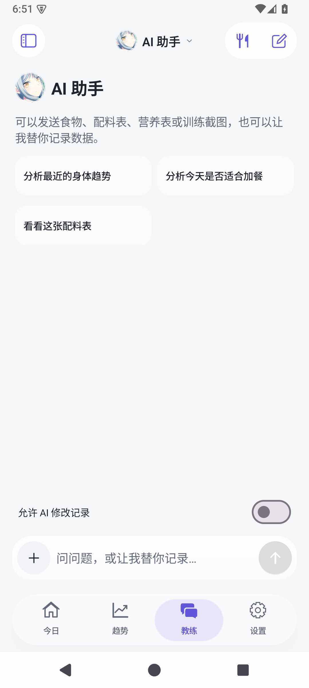
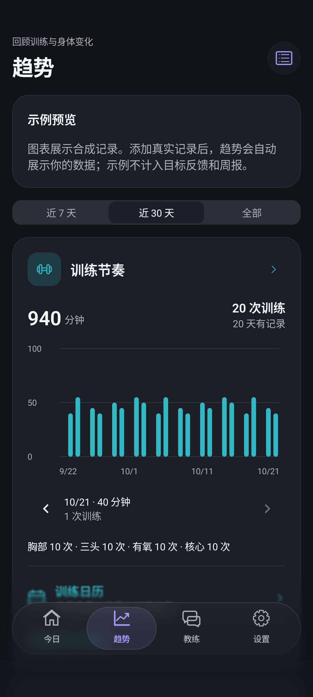
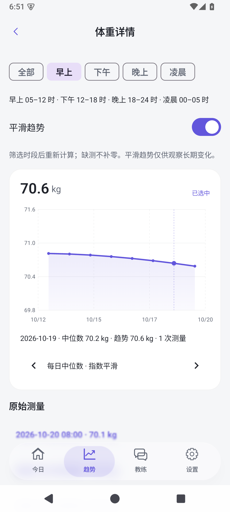
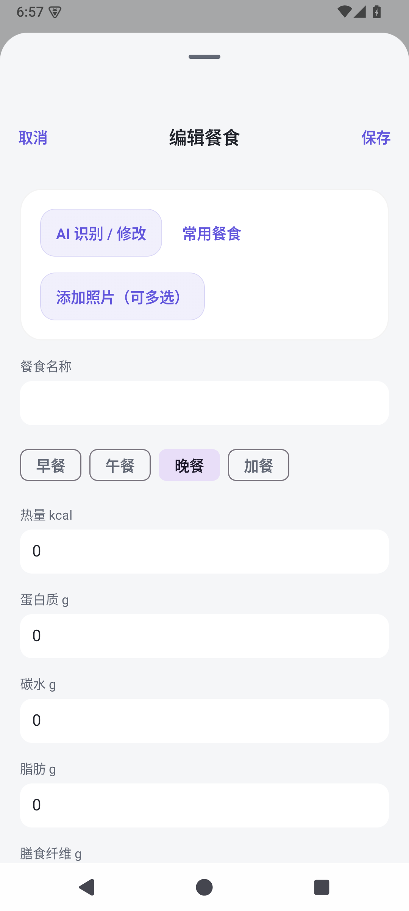
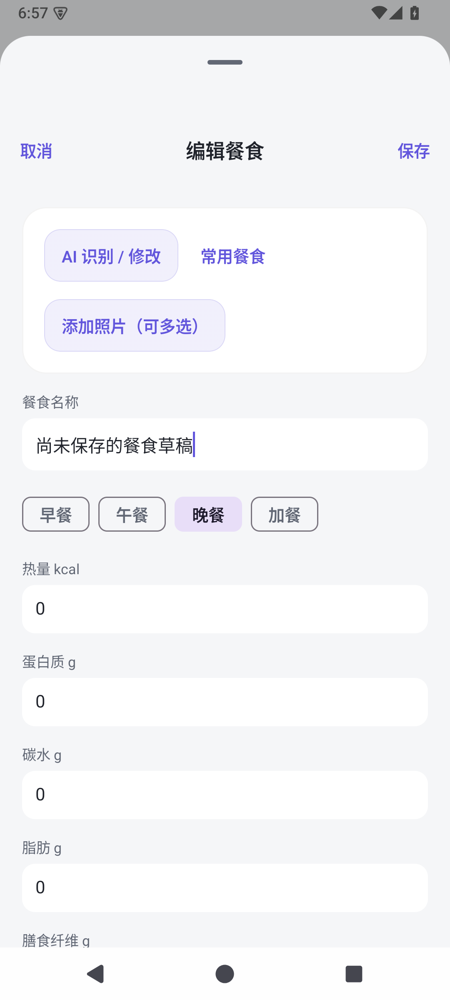
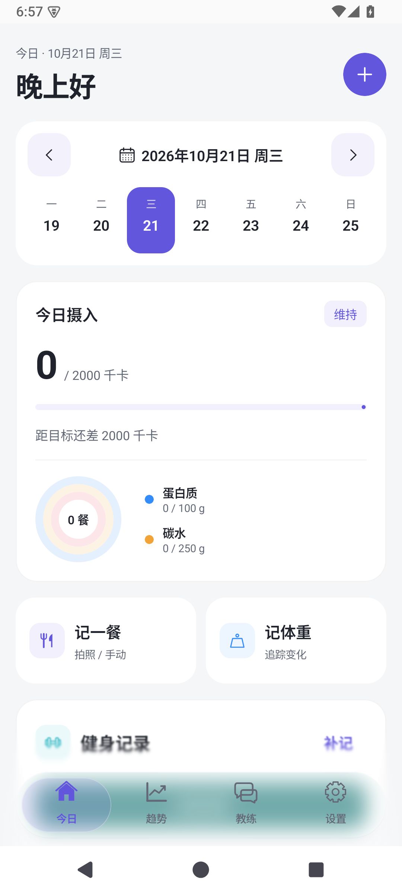

# Android 与 iOS 一致性检查 · 2026-10-21

> 本文为实施前的检查记录。已按此清单完成本机源码优化，见[实施与验证记录](android-ios-parity-2026-10-21.md)。

本轮基于当前 Android 的实际运行截图、5 个隔离模拟器检查，以及两端当前源码。保留了上一轮渐进模糊改动；本轮只增加审核报告和证据，没有修改产品逻辑。

iOS 本轮未运行截图对照，因此 iOS 部分只报告源码能确认的结构与功能差异，不作逐像素一致性判断。旧对齐文档中的截图与已完成事项没有直接当作本轮证据。

## 检查路径

| 步骤 | 页面与操作 | 状态 | 主要发现 |
| --- | --- | --- | --- |
| 1 | 今日：查看营养、选择日期 | 基本清晰，有明显对齐空间 | 周历缺少 iOS 的每天营养小圆环；同步入口在长页面底部 |
| 2 | 设置 → 个人与目标 | 分组和访问路径较一致 | 外观入口图标含义不准确；卡片材质和主题规则可统一 |
| 3 | 教练：空态、输入、键盘收起 | 主要结构和键盘流程正常 | 多张消息照片只能分别打开；完成/失败的触觉反馈尚可补齐 |
| 4 | 趋势 → 测量详情 | 范围筛选、读数和页面保留正常 | 身体总览的中位数/趋势双线展示与今日测量组织尚未对齐 |
| 5 | 添加餐食 → 输入草稿 → 活动重建 | 已复现草稿丢失，优先处理 | 识别类型入口也少于 iOS；草稿不应依赖临时 Compose 状态 |

## 优先级与建议

### 1. P1：保留编辑草稿

实测进入“编辑餐食”、输入未保存名称后执行 `ActivityScenario.recreate()`，编辑弹层消失，回到首页。该测试用于验证问题存在，测试通过表示复现成功。

`ui/App.kt:56` 的编辑目标使用 `remember`；`ui/Editor.kt:98` 起的名称、营养、日期、附图等多使用临时 `remember`。Android 活动重建后不能恢复编辑入口和草稿。建议引入明确的编辑草稿状态：文本与记录 ID 可恢复，附图保存为临时文件引用；成功保存后清除，返回离开时按是否改动提示。不要将完整照片字节写入 SavedState。

验收：餐食/体重/训练/动作编辑在活动重建后继续编辑；拍照或选图回来不丢字段；失败、取消、保存的草稿清理行为明确。这是 Android 自身的可靠性问题，不宣称已在 iOS 上复现同类场景。

### 2. P1：补齐 AI 餐食识别类型

[iOS MealScanMode](../iOS/LifeRecord/Services/AIClient.swift) 明确提供“餐盘识别 / 营养成分表 / 配料表”，录入页按模式提交不同提示词。Android `AppViewModel.kt:357` 使用一套“识别整餐营养”的提示词，编辑页也没有对应选择器。

建议在相同入口增加三个模式，并分别处理每份/每 100g、实际食用量、同餐多角度去重、缺少营养表时的不确定性。保留复核后保存的流程。此项是输入意图与识别行为对齐，单独更改按钮文案不够。

验收应使用模拟 AI 响应检查模式传参与提示词；本轮未调用计费模型，也没有判断模型实际识别准确率。

### 3. P2：相册支持连续多图浏览

Android `ui/Editor.kt:284` 的 `PhotoViewer` 只接收单张 `ByteArray`；消息中的每张缩略图分别打开该查看器。iOS `MealPhotoView.swift:98` 的查看器接收整组图片及初始图片，支持左右翻页、序号和上一张/下一张按钮。

建议统一为图片列表与初始索引，保留当前双指缩放、双击、下滑关闭和保存功能；只解码当前页与相邻页。新增页码，并在放大时优先平移图片、缩小后再翻页。该差异为源码确认，本轮未执行两端连续多图手势对照。

### 4. P2：首页周历与快捷操作对齐

Android `ui/App.kt:164` 起仅显示星期、日期和有无记录圆点。iOS `TodayView.swift:483` 使用每天的蛋白质、碳水与餐次数生成小圆环，选择状态也单独呈现。建议采用相同的信息含义、颜色映射和日期选中规则。

iOS 首页 `TodayView.swift:76` 支持下拉同步；Android 当前在首页底部提供同步按钮。建议在安卓增加下拉同步及就近的同步结果反馈，保留既有自动同步。餐食快捷长按操作可在第二批补齐，继续沿用删除确认。

无障碍验收应检查日期完整读法、已有记录状态与营养进度，不依赖颜色单独表达。

### 5. P2：身体总览的图表与测量组织对齐

Android `BodyOverviewPage.kt:25` 标题为“每日中位数与趋势”，实际调用 `TrendChart(..., true)`。该图表在 `Trends.kt:244` 只选取一套 y 值绘制。iOS `BodyDashboardView.swift:231` 同时画灰色虚线中位数和强调色实线趋势，便于区分日间波动与长期变化。

建议身体总览同时显示两条曲线并提供图例；纵轴范围覆盖两者。Android 下方当前展开所有原始历史测量；iOS 总览展示今日测量。建议总览优先展示今日数据，历史记录保持独立查看入口，兼顾已有关联记录编辑能力。

### 6. P2：长列表与图片列表按需渲染

Android `Navigation.kt:75` 的餐食历史使用 `FullForm` 内普通可滚动 Column，并对全部餐食和照片逐项展开。大量历史数据时会增加组合、照片加载和内存开销。

建议改为带稳定记录 ID 的 LazyColumn，照片列表按需加载；身体原始测量也使用同一策略。这是源码可见的性能风险，本轮没有做千条记录或真实低端手机帧率测量。新增渐进模糊还应补充滚动时的 GPU、帧率和温升验证，再决定采样降级策略。

### 7. P3：统一卡片、控件、图标和反馈

- Android `App.kt:121` 的 `Panel` 接收 `tint` 却没有使用，训练/体脂等卡片缺少 iOS `CardSurface` 中的轻微主题色材质。建议建立共同的圆角、边框、内边距和材质规则。
- Android 趋势筛选、表单 chips 和设置的分段控件风格不一，可按 iOS 的控件层级统一。保留 Android 系统的日期选择器和返回行为。
- 设置“外观与个性化”目前使用人物图标，iOS 使用调色盘；补齐含义匹配的图标。
- iOS 录入保存成功/失败有触觉反馈；安卓可在成功保存、错误和重要确认时提供系统触觉反馈。
- 图表当前有描述和前后日期按钮，仍应验证 TalkBack 的当前值播报与操作顺序，以及大字体下数值行、日期和分段控件的换行。截图不能证明完整无障碍合规。

聊天强调色属于共同优化：Android 用户气泡使用固定 `Purple`，iOS 也使用固定 `AppTheme.accent`。如要让聊天跟随用户强调色，应两端一起明确主题规则，不能将这一项描述成 iOS 已完成的优势。

## 建议实施批次

1. 草稿恢复、三种识别模式、多图查看器，先修复可靠性并补齐高频能力。
2. 首页周历营养环、下拉同步、身体总览双曲线和今日测量组织。
3. 卡片/控件/图标/触觉统一，长列表与模糊真机性能检查、TalkBack 和大字体检查。

## 本轮截图

以下截图均在本轮隔离模拟器采集，并逐张查看。原“trends-light”采集结果实际显示首页，已剔除，趋势截图改用本轮确认正确的深色页面。

### 1. 今日

### 2. 设置与个人目标

### 3. 教练

### 4. 趋势与测量详情

### 5. 录入与活动重建

