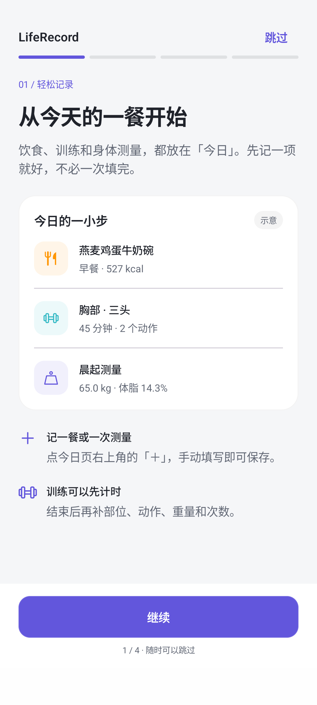
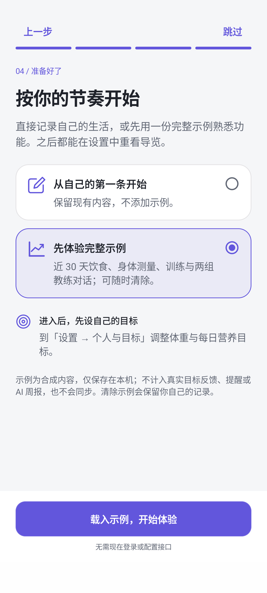
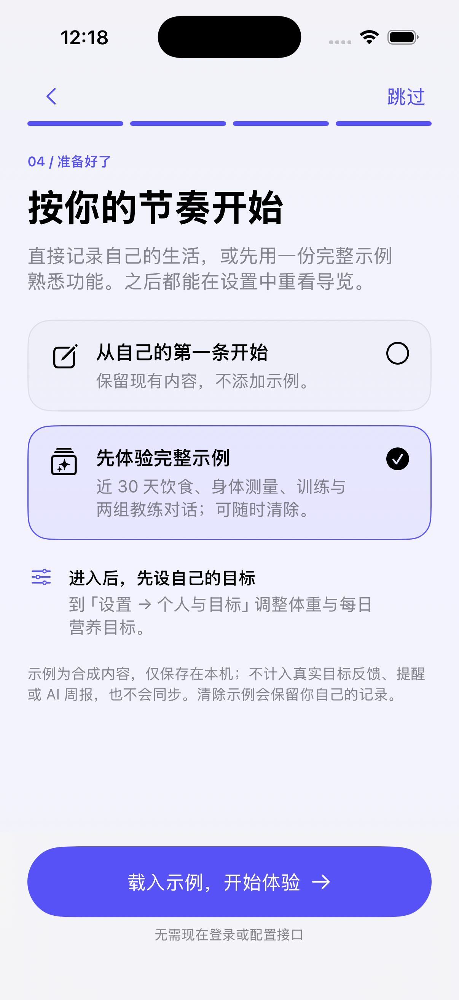
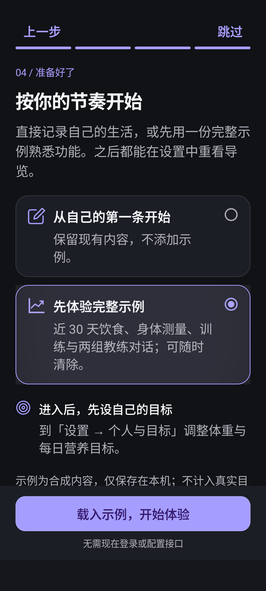

# 首次导览与示例数据

本次调整适用于 iOS 与 Android 原生客户端；Android 安装包对应 [1.4.0-beta.6](android-release-1.4-beta6.md)，iOS 为源码更新。

首次启动提供四步导览：记录入口、趋势和每日明细、教练与数据发送、开始方式。预览使用静态示意，不读写用户记录，也不调用 AI。可返回上一步或随时跳过，默认选择自己的记录；只有最后主动选择体验示例并确认，才会保存示例。设置中可以重看导览、重新载入或清除示例。

## 示例覆盖

两端使用相同的近 30 天合成场景：

| 内容 | 数量与场景 |
| --- | --- |
| 饮食 | 106 餐，覆盖早/午/晚餐与加餐，营养明细与热量换算一致 |
| 身体 | 28 次测量，覆盖体重、可选体脂和腰围；保留缺测日期 |
| 训练 | 20 次已完成训练，覆盖力量、有氧、核心、休息日；包含部位、重量/次数与计时组 |
| 教练 | 两组预先编写的使用说明对话，明确标注示例，无真实 AI 请求 |

记录时间不会晚于载入时刻。当天尚未到达的演示时间会截到当前时间；凌晨的当日训练可能跨午夜。缺测不补零，示例不覆盖用户目标、已有真实记录或真实对话。

## 数据边界

- 首屏、趋势和明细在没有真实记录时展示带标记的示例；开始记录真实内容后切换为真实数据，避免两者混算。
- 示例不参与真实目标反馈、记录质量检查、连续记录、漏记提醒、AI 周报、同步或同步 JSON 导出。
- iOS 为训练补充默认 `false` 的 `isDemo` 字段，兼容原有本机数据库；示例删除不生成同步删除标记。
- 重复载入先替换带示例标记的内容，不累计副本；清除包含示例训练与示例对话，保留真实内容。
- iOS 存在未保存草稿时拒绝载入/清除，避免保存失败回滚影响草稿。Android 在教练生成期间阻止替换示例，对记录和示例对话进行一次存储提交。

## 验证

- `./iOS/Tests/run.sh`：新增示例数据检查，覆盖重复载入、安全清除、四种餐次、午夜、训练明细、未保存草稿和真实数据保留。同步测试直接调用实际快照生成方法，确认示例训练被排除。
- Android `:app:testDebugUnitTest`：新增 `DemoDataTest`，覆盖合法字段、时间、营养换算、结构化训练、同步排除和显式示例图表。
- Android `AppFlowTest`：新增完整四步流程、预览不写入、返回与旋转恢复选择、载入、重复载入、清除、真实记录保留与跳过；在新建的一次性模拟器使用无 INTERNET 权限的 sandbox 包执行。
- 两端模拟器检查实际布局；导览内容可滚动，底部继续按钮固定。Android 额外以深色、130% 字体执行完整导览；iOS 检查深色与辅助大字体。
- 本次验证：Android 69 项单元测试、22 项 `AppFlowTest` 通过；iOS 完整 Swift 回归和两端构建通过。

## 预览

| Android 记录导览 | Android 开始方式 |
| --- | --- |
|  |  |

| iOS 开始方式 | Android 深色大字体 |
| --- | --- |
|  |  |
