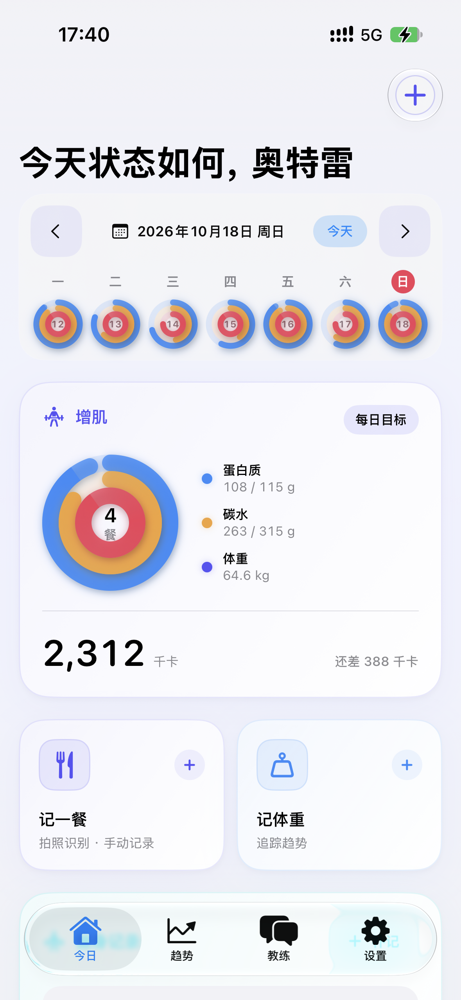
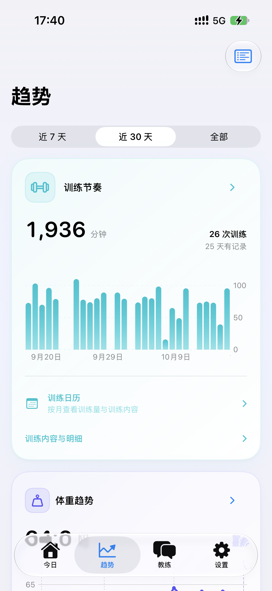
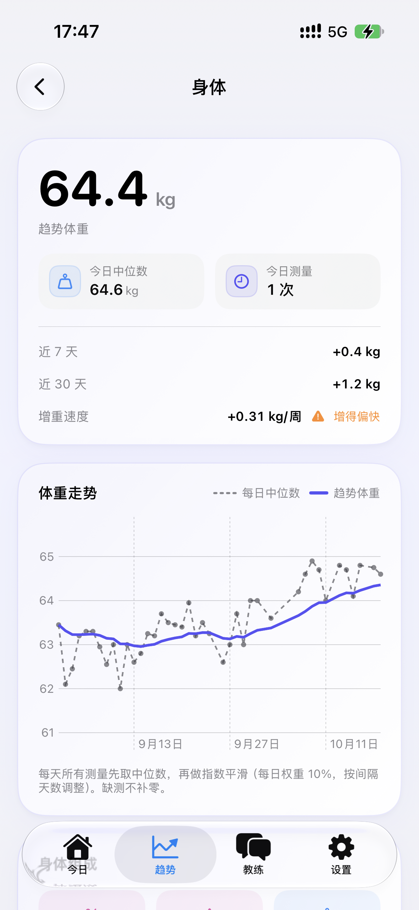
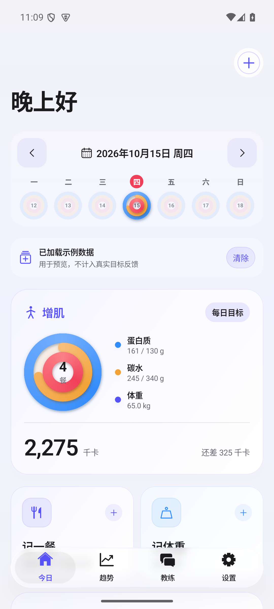
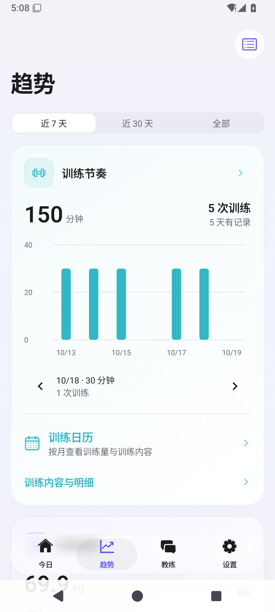
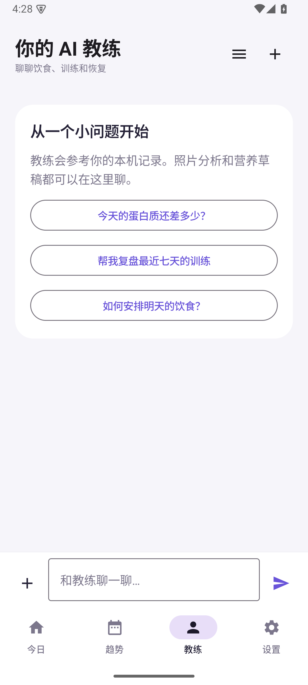

# LifeRecord

**把饮食、训练与身体变化，记录在一起。**

LifeRecord 是一款本地优先的饮食与健身记录应用，提供 iOS、Android 原生客户端和网页端。从一餐、一组训练到长期体重趋势，把日常记录整理成看得懂、能回顾的数据，适合增肌、减脂或维持体重时持续使用。

[安卓下载](https://github.com/Apson-Chian/LifeRecord/releases) · [网页体验](https://apsonchian.ltd/liferecord-default/) · [iOS 工程](iOS/)

## 项目亮点

- **记餐更省事**：支持手动填写、文字描述和多张照片识别，记录热量与宏量营养；常用餐食可直接复用，识别结果可编辑后保存。
- **训练按自己的习惯记录**：选择部位、开始计时即可记录，也能补填动作、重量、次数与组数；支持补记和跨午夜训练。
- **从记录看到变化**：结合体重、体脂、腰围、营养和训练数据，按 7 天、30 天或全部历史查看趋势、日历与目标反馈，缺测日期不会被当作零值。
- **有上下文的智能教练**：结合已有记录讨论饮食与训练，支持图片、多对话和周报；记录写入需主动授权，重要修改提供复核流程。
- **原生体验**：iOS 使用 SwiftUI，Android 使用 Jetpack Compose，提供圆环目标、玻璃导航、深浅色外观和适合手机的录入方式。
- **本地记录，可选同步**：手机端可离线记录；连接私有同步服务后，在手机和浏览器之间同步餐食、身体测量、训练与目标，也可导出 JSON 留存。

## 界面预览

### iOS

<table>
  <tr>
    <th>今日记录</th>
    <th>训练节奏</th>
    <th>身体总览</th>
  </tr>
  <tr>
    <td></td>
    <td></td>
    <td></td>
  </tr>
</table>

iOS 真机截图。[更多 iOS 界面](iOS/README.md#界面预览)

### Android

<table>
  <tr>
    <th>今日记录</th>
    <th>训练趋势</th>
    <th>智能教练</th>
  </tr>
  <tr>
    <td></td>
    <td></td>
    <td></td>
  </tr>
</table>

Android 预览使用示例或合成记录。

## 下载与体验

| 平台 | 使用方式 |
| --- | --- |
| Android 8.0+ | [下载 beta.6](https://github.com/Apson-Chian/LifeRecord/releases/tag/android-v1.4.0-beta.6) · [全部版本](https://github.com/Apson-Chian/LifeRecord/releases) |
| iOS 17+ | 使用 Xcode 构建 [iOS 工程](iOS/README.md)，目前尚未提供 TestFlight 下载 |
| Web | [网页体验](https://apsonchian.ltd/liferecord-default/) |

新安装默认使用服务器提供的 AI 服务，连接自己的独立同步账号即可使用，无需填写上游 API Key；也可以切换到自定义模型接口。已有安装保留用户原先选择的接口。

首次使用可以直接从空白记录开始，填写自己的目标；照片识别和智能教练需要联网并配置服务。当前 iOS 源码、Android 和网页支持用户自行注册账号密码，无需管理员分配；旧同步密钥继续兼容。Android 账号客户端已包含在 beta.6，iOS 需安装新源码构建；自主注册后端尚未部署到上述在线服务，服务器未升级时请继续使用密钥连接。[账号与同步说明](Docs/public-beta.md)

**版本升级**：beta.6 可直接覆盖 beta.4/5，保留本机数据；beta.3 及更早版本需先核对同步记录、另存本机内容，再卸载重装，本机对话和部分照片不参与同步。[本版更新说明](Docs/android-release-1.4-beta6.md) · [旧版本迁移](Docs/android-release-1.4-beta4.md#签名与发布状态)

## 技术与目录

| 目录 | 技术与职责 |
| --- | --- |
| [iOS/](iOS/) | SwiftUI、SwiftData、Swift Charts；原生界面、本机存储与趋势展示 |
| [Android/](Android/) | Kotlin、Jetpack Compose、SQLite；原生界面、本机存储与后台提醒 |
| [Web/](Web/) | HTML、CSS、JavaScript；浏览器记录管理与趋势查看 |
| [Backend/](Backend/) | Python、SQLite；账号、记录同步与私有照片服务 |
| [Tests/](Tests/) / [Docs/](Docs/) | 跨端回归检查、功能说明与统计口径 |

项目统一在 `main` 维护，已包含默认 AI 服务。两个原生工程可独立构建。

## 本地运行

Android：使用 JDK 17、Android SDK 35，在 Android Studio 中打开 `Android/`，或执行：

```sh
cd Android
./gradlew :app:assembleDebug
```

iOS：使用 Xcode 打开 `iOS/LifeRecord.xcodeproj`，选择模拟器运行；真机运行需配置自己的签名团队。

平台配置与检查：[Android 开发说明](Android/README.md) · [iOS 开发说明](iOS/README.md) · [接口设置](Docs/api-settings.md)

## 数据与隐私

手机端记录保存在本机，接口与同步密钥使用系统安全存储。开启同步后，参与同步的记录与餐食照片会上传到所配置的服务器；使用智能功能时，相关文字、记录和所选图片会发送到配置的 AI 服务。聊天附件、常用餐食照片等本机内容并不全部参与同步或导出，卸载前应另行保留。

项目用于日常记录与复盘，营养估算和教练建议仅供参考。
